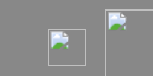

# Grok Workspace — Mission Overview

> Engineering field guide to the imported Grok application workspace. This document inventories the archived source and its visible interface assets; it does not claim a fresh build or runtime validation.

## Mission summary

The workspace is a self-contained application project imported from the supplied ZIP archive. Its source tree, configuration, migrations, scripts, public assets, and interface captures are preserved beneath `grok-workspace/`. The repository retains its pre-existing files and the original ZIP for provenance.

## Systems inventory

| Subsystem / directory | Contents |
|---|---|
| `grok-workspace/(workspace root)/` | 10 files; `.node_modules.lock`, `.prettierrc`, `AGENTS.md`, `eslint.config.mjs`, `package-lock.json`, and 5 more |
| `grok-workspace/.grok/` | 90 files; `.grok/app-env.json`, `.grok/favicon-preview.png`, `.grok/references/browser-qa.md`, `.grok/references/data-and-auth.md`, `.grok/references/deploy-target.md`, and 85 more |
| `grok-workspace/migrations/` | 1 files; `migrations/auth/0001_auth.sql` |
| `grok-workspace/public/` | 10 files; `public/__grok/icon-180.png`, `public/__grok/install/assets/homescreen/glass-puzzle.svg`, `public/__grok/install/assets/homescreen/glass-share.svg`, `public/__grok/install/assets/homescreen/logo-grok.svg`, `public/__grok/install/assets/homescreen/ob-ipad.png`, and 5 more |
| `grok-workspace/screenshots/` | 1 files; `screenshots/.gitkeep` |
| `grok-workspace/scripts/` | 26 files; `scripts/app-env-plugin.mjs`, `scripts/brand-check.mjs`, `scripts/brand-check.test.mjs`, `scripts/browser-guard.mjs`, `scripts/browser-smoke-verdict.mjs`, and 21 more |
| `grok-workspace/server/` | 2 files; `server/middleware/grok-pwa.ts`, `server/virtual-grok-og-identity.d.ts` |
| `grok-workspace/src/` | 65 files; `src/components/preview-host-bridge.tsx`, `src/components/studio/studio.tsx`, `src/components/studio/widgets.tsx`, `src/lib/app-data/app-data.test.ts`, `src/lib/app-data/client.server.ts`, and 60 more |

**Archive inventory:** 205 files, 56 directory entries, and 5 image assets.

## Screenshots and visual assets

*Figure: Favicon Preview — archived visual asset at `grok-workspace/.grok/favicon-preview.png`.*

*Figure: Icon 180 — archived visual asset at `grok-workspace/public/__grok/icon-180.png`.*

*Figure: Ob Ipad — archived visual asset at `grok-workspace/public/__grok/install/assets/homescreen/ob-ipad.png`.*

*Figure: Ob Phone — archived visual asset at `grok-workspace/public/__grok/install/assets/homescreen/ob-phone.png`.*

*Figure: Og — archived visual asset at `grok-workspace/public/og.jpg`.*

## Launch checklist

1. Install a currently supported Node.js LTS release if this is a JavaScript/TypeScript application.
2. Review `grok-workspace/package.json`, `AGENTS.md`, and project-specific configuration before running commands.
3. Install dependencies using the lockfile-appropriate command (typically `npm ci`) in a controlled environment.
4. Inspect environment-variable requirements and migrations before starting any services.
5. Use the documented development, type-check, lint, and test scripts where present; record actual results separately.
6. Treat archived build output as historical evidence, not proof of a fresh reproducible build.

## Mission log

- Import date (UTC): 2026-11-06
- Import commit: `074d870a56dc6d1d64187e748c6ceb9835bef776`
- Source archive: `grok-workspace-1-1.zip`
- Archive integrity: passed during extraction; extracted files are listed in `grok-workspace-import-manifest.json`.
- History policy: branch-first; no force-push; existing main history is retained.
